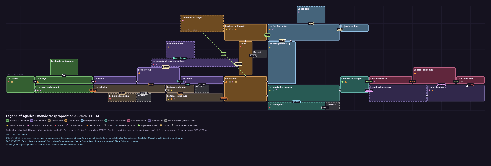

# Monde V2 : la nouvelle carte, conçue de zéro

Version du 2026-11-16, après « on peut rien faire de bien sur une base bancale, refais tout un plan,
toute une carte de 0 ». Rien ne part des zones actuelles ; seuls les mécaniques, les personnages et
l'art des biomes sont repris. Rien n'est encore changé dans le jeu.

**Fichiers :**
- `docs/production/monde_v2/monde.json` : la carte en données (zones, passages, verrous, contenu).
  C'est la source unique.
- `docs/production/monde_v2/carte.png` : la carte dessinée.
- `tools/monde_v2.py` : contrôle la carte et la redessine (`python tools/monde_v2.py`).

**Tes réponses du 2026-11-16 :**
- trame souple : on peut déplacer des événements, le fond de l'histoire reste ;
- durée visée : environ 1 h 30 pour l'histoire, plus 1 h de secrets ;
- formes obligatoires : « au plus naturel », mais surtout pas une ligne droite ;
- bosquet : retour en cachette.

## 1. Les règles de conception

1. **Chaque zone a une raison d'exister** : une scène de l'histoire, une forme à obtenir, un verrou à
   montrer, un raccourci ou une récompense. Aucune zone de remplissage ; les fiches du § 7 donnent la
   raison de chacune.
2. **On voit le verrou avant d'avoir la clé.** Chaque forme obligatoire est vue fermée dans 2 à
   7 zones avant d'être obtenue (mesuré par le script, § 9). Xara commente chaque passage fermé.
3. **On se sert d'une forme tout de suite** :
   - la sortie de la tanière du loup demande le loup ;
   - le combat de Kainati se joue dans les lianes, juste après le totem du singe ;
   - le mur de mousse est derrière la hutte de Morgat ;
   - on sort des profondeurs en soignant.
4. **Pas une ligne droite.** Après le loup, quatre buts dans l'ordre qu'on veut (§ 5). Chaque région a
   des boucles et des raccourcis qui s'ouvrent de l'intérieur.
5. **Revenir en arrière paie toujours** : cœur, papillon perdu, talisman, raccourci, scène d'histoire
   (le père dans les caves, le secret de Xara).
6. **Aucun cul-de-sac.** On ne change de forme (sol : loup ou grizzly ; air : singe, aigle ou ours-hibou)
   qu'au feu de camp. Chaque endroit qui demande deux formes du même emplacement a donc un feu dans la
   zone ou juste à côté (contrôlé par le script).
7. **Aucune punition par accident** : on ne tombe jamais sans le vouloir dans une zone dont on ne peut
   pas ressortir.
8. Tes règles de level design restent valables partout, en particulier pas de diagonale vide dans le
   sol.

## 2. L'histoire : ce qui bouge

Le fond ne change pas :
- le bannissement à cause d'Amanite ;
- Xara et son secret ;
- Kainati épargné ;
- Geralt et Clak ;
- la plante et Morgat ;
- la défaite contre Ghil't, le papillon, le soin ;
- Amanite qui l'achève, et le retour au bosquet.

Ce qui change, et pourquoi :

| # | Changement | Pourquoi |
|---|---|---|
| 1 | Le père confie le talisman de l'ours **au début** du prologue (le rite de la première forme) | l'ours sert tout de suite : on libère la source, puis on descend sous la forêt |
| 2 | Le totem du loup est dans une **tanière sous la forêt**, gardé par le loup alpha | on y descend en cassant le sol du carrefour : première fois que le monde s'ouvre vers le bas |
| 3 | Le totem du singe s'allume à la cime ; **Kainati attaque** parce qu'il croit qu'on le vole, et le combat se joue dans les lianes | on teste le singe aussitôt obtenu (déjà l'ordre du jeu actuel) ; épargné, Kainati donne la carte du ciel |
| 4 | L'aigle s'obtient **sur les escarpements**, avant ou après le singe | deux chemins vers le ciel : par l'arbre (singe) ou par la falaise (aigle) |
| 5 | Le **grizzly entre dans l'histoire** : la tanière des ours du peuple d'Agarica | sa charge ouvre l'entrée de la forêt corrompue ; ça donne un sens au talisman familial de l'ours |
| 6 | Morgat peut être rencontrée **avant** d'avoir la plante | le marais se visite tôt ; elle explique ce qu'il faut, puis prépare le répulsif quand on revient |
| 7 | Amanite se retrouve **au jardin de lune**, sur la plante. Ses coups de lance se voient sur les cadavres de la lisière morte | la divergence se joue sur l'objet même de la quête ; ses traces annoncent la fin sans la dire |
| 8 | **Plus de crash** : on entre dans la forêt corrompue par le mur de mousse derrière la hutte | le répulsif sert dès qu'on l'a |
| 9 | Le trou sombre devient **les profondeurs**, une vraie zone | on y apprend le papillon en remontant ; une racine noire qui pulse annonce la suite |
| 10 | **Geralt donne la carte région par région** (4 rencontres), Kainati celle du ciel | une raison de chercher Geralt ; la carte se remplit en explorant |
| 11 | Après l'écran de fin, **on peut continuer** à explorer, avec le village rouvert | on finit les secrets avec toutes les formes |

Il y a aussi trois scènes facultatives qui récompensent l'exploration :
- **les caves du bosquet** : on entend le père défendre sa fille à travers le plancher ;
- **le nid de Maexxna** : le secret de Xara est suggéré, pas révélé ;
- **le cercle de lune** : l'histoire du Cercle de la Lune d'Agarica.

## 3. Les capacités et ce qu'elles ouvrent

Les cassables suivent ta règle : **l'ours brun casse les sols, le grizzly casse les murs**.
L'ours-hibou casse en plus les **dalles épaisses**, en retombant de haut.

| Capacité | Emplacement | Où on l'obtient | Ce qu'elle ouvre | Obligatoire |
|---|---|---|---|---|
| Ours brun | compétence | le village (le père, prologue) | sols fissurés | oui |
| Loup | forme au sol | tanière du loup (loup alpha) | grands ravins, pistes, plateformes cachées | oui |
| Grizzly | forme au sol (à la place du loup) | tanière des ours | murs fissurés (charge) | oui |
| Singe | forme aérienne | cime (Kainati) | lianes, second saut | oui |
| Aigle | forme aérienne | escarpements (l'aire) | plané, courants d'air, second saut plus haut | oui |
| Répulsif | objet | hutte de Morgat (avec la plante) | murs de mousse toxique | oui |
| Papillon | compétence | profondeurs | barrières et créatures corrompues | oui |
| Ours-hibou | forme aérienne | nid du hibou | dalles épaisses, second saut | non |
| Pieuvre | forme d'eau | îlot du marais | eau profonde (nager dessous) | non |
| Ours polaire | compétence | pic gelé | eau traversée en surface (glace) | non |
| Pierre | compétence | épreuve du singe | cibles suspendues, attaque à distance | non |
| Panda | compétence | caves du bosquet | rien : soigne 1 cœur | non |

Le crapaud reste hors du monde, comme tu l'as dit.

## 4. La carte



- **33 zones** : 21 sur le chemin de l'histoire, 8 facultatives et 4 zones cachées.
- **8 régions** : Bosquet, Forêt sombre, Sous la forêt, Grand arbre, Escarpements et ciel, Marais,
  Forêt corrompue, Profondeurs.
- La géographie se tient :
  - le bosquet est à l'ouest, sur un plateau au-dessus de ses caves ;
  - la forêt sombre est au centre, avec ses galeries en dessous ;
  - le grand arbre monte jusqu'au ciel ;
  - la falaise des escarpements surplombe le marais ;
  - la corruption s'étend à l'est et descend dans les profondeurs ;
  - la plante pousse sur un rocher au-dessus de la corruption, la seule chose qu'elle ne touche pas.
- Une case de la carte vaut un écran (960 × 576 px). L'ensemble fait environ 170 écrans, contre
  environ 100 aujourd'hui.

## 5. Le parcours : un ordre libre

```
Prologue (bosquet) ── bannissement ── lisière ── carrefour (Xara) ── galeries ── LOUP
                                                                                  │
            ┌───────────────────┬────────────────────┬───────────────────┬────────┘
            ▼                   ▼                    ▼                   ▼
   SINGE (arbre, Kainati)   AIGLE (escarpements)   GRIZZLY (tanière     Morgat, 1re visite
            │                   │                   des ours)            (facultative)
            │                   ▼                    │                   │
            │              PLANTE (jardin, Amanite)  │                   │
            │                   ▼                    │                   │
            │              RÉPULSIF (Morgat) ◄───────┼───────────────────┘
            ▼                   ▼                    ▼
            └───────► FORÊT CORROMPUE (mousse + grizzly + singe) ◄─┘
                                ▼
                 Ghil't (défaite) ── profondeurs : PAPILLON ── Ghil't soigné ── fin
```

Après le loup, il y a quatre buts dans l'ordre qu'on veut. La forêt corrompue demande les trois formes
et le répulsif. Le script le vérifie : le singe, l'aigle et le grizzly ne demandent que le loup.

Trois exemples de parties :
- **Par l'arbre** : loup → racines → tronc → cime (singe) → îles → on tombe aux escarpements (aigle) →
  jardin (plante) → marais → Morgat (répulsif) → mur de pierre fermé → retour à la tanière des ours
  (grizzly) → forêt corrompue.
- **Par la falaise** : loup → escarpements (aigle) → îles → jardin (plante) → Morgat → mur de pierre →
  tanière des ours → forêt corrompue : il faut des lianes → retour à l'arbre (singe) → forêt corrompue.
- **Le curieux** : loup → il casse aussitôt le sol de la tanière (grizzly) → les caves du bosquet
  (panda, le père) → le reste.

Durée estimée, au premier passage :
- **histoire** : 109 minutes, plus les allers-retours, soit 1 h 45 à 2 h ; un peu au-dessus de ton
  1 h 30 ;
- **facultatif** : 35 minutes de zones, plus les cœurs, les papillons et les retours, soit environ 1 h.

Ce sont des estimations : on resserrera au chronomètre pendant la construction en blocs.

## 6. Ce qu'on trouve

- **Cœurs** : on part avec 3, et il y a **7 graines de cœur**, chacune derrière une capacité
  différente :

  | Où | Ce qu'il faut |
  |---|---|
  | lisière | loup |
  | source | second saut, en revenant par les caves |
  | cercle de lune | second saut |
  | tronc | grizzly |
  | nid de Maexxna | ours-hibou |
  | lac englouti | pieuvre |
  | puits des cocons | papillon |

  Le passif des ursidés en ajoute un.
- **Papillons perdus de Morgat : 9**, au plus un par zone, chacun derrière un petit détour.
  - Tous les 3 papillons, la compétence du papillon gagne un niveau.
  - Morgat les reconnaît : ce sont les siens, partis chercher des plantes.
- **Cartes** :
  - Geralt en donne 4 (forêt et dessous, arbre, marais, forêt corrompue), Kainati celle du ciel ;
  - le bosquet est connu dès le départ ;
  - les profondeurs restent sans carte.
- **Feux de camp : 9** : village, carrefour, racines, cime, îles, tanière des ours, hutte, cœur corrompu,
  profondeurs.
- **Éclats de lune** :
  - on en gagne sur les ennemis et dans les coffres (fond du bassin de la source : pieuvre ;
    sous la dalle des racines : ours-hibou) ;
  - **Tamarin**, le marchand, s'installe au carrefour quand on revient avec le loup.

## 7. Les zones, une par une

Taille en écrans (largeur × hauteur). « Vu » : les verrous qu'on y voit avant d'avoir la clé.

### Bosquet d'Émeraude : prologue, retour en cachette, épilogue

| Zone | Pourquoi elle existe | Vu, sorties |
|---|---|---|
| **Le village** (4×1) | Prologue : marcher, sauter, couper les ronces de mousse à la dague. Le père confie le talisman de l'ours. Feu de camp. On y revient pour l'épilogue. | Sorties vers la source (ouest), les hauts (en haut) et la porte de l'Est. Après le bannissement, tout est barré jusqu'à la fin. |
| **La source** (2×2) | Le bassin est étouffé par la mousse : on casse un sol fissuré avec l'ours pour libérer l'eau. C'est le tutoriel de l'ours, et l'eau qui recoule est la récompense. Premier petit monstre de mousse. | Dès le prologue, on voit : un cœur sur une corniche trop haute (second saut), le fond du bassin où l'eau s'engouffre (pieuvre : un coffre), une porte barrée vers les caves. |
| **Les hauts du bosquet** (2×2) | La nuit, Agarica voit Amanite monter au sanctuaire : vol de l'idole, mensonge, découverte, bannissement. On y apprend le petit saut. | Se rouvre après la fin. |
| **Les caves du bosquet** (4×1, facultatif) | Le retour en cachette, par le mur fissuré des galeries (grizzly). On entend le père défendre sa fille à travers le plancher. Sur l'autel des anciens guérisseurs, le talisman du panda. Papillon 9. | On débarre de l'intérieur la porte de la source : elle redevient visitable (cœur, coffre). |

### Forêt sombre

| Zone | Pourquoi elle existe | Vu, sorties |
|---|---|---|
| **La lisière** (3×1) | Bannie, seule, la nuit : premiers vrais combats (loups sanguinaires). La porte de l'Est est barrée derrière soi. | Un cœur de l'autre côté d'un ravin trop large (loup). |
| **Le carrefour** (3×2) | La clairière centrale, où l'on repasse souvent. Rencontre de Xara, feu de camp, plus tard Tamarin. Au loin dans le ciel, le rocher de lune où brille la plante. | Le grand ravin à l'est (loup) et la corniche de la canopée (second saut). Le sol sonne creux : Xara le fait remarquer, on le casse avec l'ours et on descend aux galeries. |
| **Les ravins** (3×1) | Après le loup : longs sauts, pistes et plateformes cachées. Geralt et son combat ridicule : carte de la forêt. Papillon 2, par les plateformes cachées. | Bloc SECRET : terre meuble (canidé). On repart vers les racines. |
| **La canopée et le cercle de lune** (6×1, facultatif) | Les branches au-dessus du carrefour, jusqu'au tronc : un raccourci. Le cercle de lune : pierres levées et fresque des formes, l'histoire du Cercle de la Lune. Cœur, papillon 4. | Des plateformes fantômes montent vers le nid du hibou (loup puis second saut). |
| **Le nid du hibou** (2×2, facultatif) | Un nid géant dans les hautes branches, avec le totem de l'ours-hibou. On en sort en cassant la dalle du nid en retombant : premier usage. | — |

### Sous la forêt

| Zone | Pourquoi elle existe | Vu, sorties |
|---|---|---|
| **Les galeries** (5×1) | Les tunnels sous le carrefour, avec araignées et toiles. Un escalier de racines permet de remonter au trou. | Mur fissuré à l'ouest (grizzly : les caves). Dalle gravée d'araignées (ours-hibou : nid de Maexxna). Mousse sur une niche (répulsif : papillon 1). Bloc SECRET : fente minuscule (insecte). |
| **La tanière du loup** (2×1) | Le loup alpha garde le totem du loup. On ressort par le haut grâce aux plateformes cachées : on se sert du loup aussitôt obtenu. | Un sol fissuré (ours) mène à la tanière des ours. On peut y descendre tout de suite, et en remonter sans le loup. |
| **La tanière des ours** (4×1) | L'ancienne tanière des ours du peuple d'Agarica : griffures et fresques. De longs sauts (loup) mènent au totem du grizzly, avec un feu de camp à côté pour changer de forme. Papillon 7. | Sortie est : un mur fissuré (grizzly) vers les racines, qu'on voit aussi depuis les racines. C'est un raccourci. |
| **Le nid de Maexxna** (2×1, facultatif) | Sous la dalle, la salle du trône d'une reine araignée. Les fresques montrent une araignée couronnée aux yeux de Xara. Xara : « Ne restons pas ici. » Cœur. | — |

### Grand arbre

| Zone | Pourquoi elle existe | Vu, sorties |
|---|---|---|
| **Les racines** (3×3) | Le pied de l'arbre : ponts et tunnels de racines sur trois étages. Feu de camp. Geralt ne sait pas grimper : il donne la carte de l'arbre et reste en bas. L'arche de l'épreuve est ici. | Sorties : tronc (en haut), escarpements (à l'est, en haut), marais (à l'est, en bas). Lianes trop hautes (singe). Noix suspendue (pierre : papillon 3). Dalle (ours-hibou : coffre). Mur fissuré de la tanière des ours. |
| **Le tronc** (1×4) | L'intérieur creux de l'arbre : la grande montée, avec des singes corrompus. | Porte de la canopée (second saut). Mur fissuré (grizzly : cœur). Bloc SECRET : paroi lisse (félin). |
| **La cime de Kainati** (3×2) | Le totem du singe s'allume, Kainati attaque. On le combat dans les lianes, on l'épargne, et il donne la carte du ciel. Feu de camp. | Lianes de la couronne vers les îles (singe). |
| **L'épreuve du singe** (poche, facultatif) | Le monde des ancêtres, par l'arche des racines : une course de lianes sans toucher le sol, plus courte qu'aujourd'hui. Talisman du singe : la pierre. | — |

### Escarpements et ciel

| Zone | Pourquoi elle existe | Vu, sorties |
|---|---|---|
| **Les escarpements** (2×5) | Une falaise à l'est de l'arbre. On grimpe sans forme spéciale ; l'aire de l'aigle (totem) demande un saut de loup. D'en haut, on se laisse tomber : c'est la redescente rapide depuis le ciel. | La colonne de courant d'air vers les îles (aigle), visible dès la première visite. |
| **Les îles flottantes** (5×2) | Les îles au-dessus des nuages : des lianes à l'ouest (depuis la cime), des courants d'air à l'est. Feu de camp pour changer entre singe et aigle. Papillon 5. | Le rocher de lune derrière un vide immense (aigle). Un courant d'air vers les nuages (pic gelé). |
| **Le jardin de lune** (2×1) | Le rocher où pousse la plante que la mousse évite. Amanite est là : les deux amies veulent toujours sauver la forêt, mais plus de la même façon. On prend une pousse. | Retour au plané, ou en tombant par les escarpements. |
| **Le pic gelé** (2×2, facultatif) | Au-dessus des nuages, du givre et du silence. Talisman de l'ours polaire. | — |

### Marais des brumes

| Zone | Pourquoi elle existe | Vu, sorties |
|---|---|---|
| **Le marais** (5×2) | Un bassin brumeux sous les escarpements : passerelles, crapauds, eau profonde. L'îlot du totem de la pieuvre s'atteint par les lianes (singe) ou sur la glace (ours polaire). Geralt est chez les crapauds : carte du marais. Papillon 6, au milieu de la mare. | L'eau profonde (pieuvre : lac englouti). |
| **La hutte de Morgat** (2×2) | Une hutte pleine de papillons. Sans la plante, Morgat explique ce qu'il faut et montre le totem de poche cassé ; avec la plante, elle prépare le répulsif. Feu de camp. | Dès la première visite : le mur de mousse derrière la hutte (répulsif, qui sert aussitôt) et la barrière corrompue en dessous (papillon : puits des cocons). |
| **Le lac englouti** (4×1, facultatif) | Sous le marais, à la nage (pieuvre) : des ruines englouties et un cœur. | Bloc SECRET : un courant trop fort à remonter (poisson). |

### Forêt corrompue et profondeurs

| Zone | Pourquoi elle existe | Vu, sorties |
|---|---|---|
| **La lisière morte** (3×1) | Arbres morts et créatures corrompues. Des cadavres percés par la lance d'Amanite : elle est passée avant. Geralt donne la carte de la forêt corrompue. Papillon 8. | Un mur fissuré (grizzly), obligatoire. |
| **Le cœur corrompu** (3×2) | Des fosses de mousse mortelle sous la canopée morte, qu'on franchit par les lianes (singe). Feu de camp à l'entrée, avant Ghil't. | Le puits vers les profondeurs, fermé par des barrières corrompues (papillon). |
| **L'antre de Ghil't** (2×1) | Premier combat : défaite imposée, la chute. Second combat : le soin au papillon. Amanite l'achève, Geralt arrive, puis l'épilogue au village. | — |
| **Les profondeurs** (4×2) | On se réveille dans le noir parmi les papillons ; le bocal d'antidote et le totem de poche donnent le papillon. Feu de camp. On remonte en soignant des créatures et des barrières corrompues : on apprend le papillon en s'en servant. Plus bas, une racine noire qui pulse : la mousse vient de plus profond. | Sortie haute : le puits vers le cœur corrompu (papillon). |
| **Le puits des cocons** (4×2, facultatif) | Des cocons de créatures à soigner, et un cœur. | Un raccourci vers la hutte, par la barrière (papillon). |

### Zones cachées, pour les formes à venir

Chaque zone cachée fait un écran et contient un socle vide, l'emplacement du futur totem. Son entrée est
fermée par un **bloc SECRET** : un rectangle provisoire où est écrit « SECRET ».

| Zone | Entrée | Forme attendue |
|---|---|---|
| Le terrier | terre meuble, dans les ravins | un canidé qui creuse (renard ou blaireau) |
| La fente | fente minuscule, dans les galeries | un insecte |
| La paroi | paroi lisse, dans le tronc | un félin qui griffe |
| Le courant | courant trop fort, au bout du lac englouti | un poisson |

## 8. Ce qu'il faut fabriquer

**Code**, à essayer d'abord dans la zone de test :
- les cassables séparés : sol (ours brun et ours-hibou), mur (charge du grizzly), dalle (ours-hibou) ;
- le bloc SECRET ;
- la glace sur l'eau (ours polaire) ;
- la cible suspendue (pierre) ;
- la barrière corrompue (papillon), si l'actuelle ne suffit pas ;
- la carte du joueur remplie région par région ;
- une nouvelle version de la sauvegarde (les parties actuelles ne seront plus valables).

**Images**, trois propositions à chaque fois, puis pixel-fixer :
- **totems de forme** (allumé et éteint) : grizzly, ours-hibou ;
- **talismans** (médaillons de compétence) : panda, ours polaire ;
- les images qui existent déjà sont reprises : totems du loup, du singe, de l'aigle et de la pieuvre ;
  talismans de l'ours et du singe ; totem de poche du papillon ;
- les **décors du bosquet** sont refaits.

**Repris tel quel** :
- toutes les mécaniques et les ennemis ;
- les boss Kainati, Ghil't et le loup alpha ;
- les dialogues et cinématiques, déplacés et adaptés ;
- l'éditeur et la carte globale.

**Art par région** :

| Région | Art repris |
|---|---|
| Bosquet | tuiles faites main, décors refaits |
| Forêt sombre et galeries | art de la forêt sombre |
| Grand arbre et escarpements | écorce |
| Ciel | tuiles flottantes ; givre ajouté pour le pic gelé |
| Marais | art du marais actuel, avec l'eau |
| Corrompue et profondeurs | tuiles corrompues |

**Ce qui part** :
- les 24 zones actuelles : elles sont gardées en « anciennes zones » jusqu'à ce que le nouveau monde
  soit jouable de bout en bout, puis retirées ;
- le crash ;
- le monde spirituel.

## 9. Les contrôles automatiques

`python tools/monde_v2.py` vérifie la carte avant qu'on construise quoi que ce soit. Résultat actuel :
- **géométrie** : aucune zone ne se chevauche, et chaque passage relie deux zones qui se touchent ;
- **fin** : atteignable depuis le bannissement. 29 zones sur 33 sont atteignables ; les 4 autres sont
  les zones cachées, fermées exprès ;
- **obligatoires** : ours brun, loup, grizzly, singe, aigle, répulsif, papillon ;
- **prérequis** : le singe, l'aigle et le grizzly ne demandent que le loup (c'est l'ordre libre). La
  plante demande l'aigle, le répulsif la plante ;
- **verrous vus avant la clé** :

  | Capacité | Zones où on la voit avant de l'avoir |
  |---|---|
  | loup | 4 |
  | grizzly | 4 |
  | singe | 7 |
  | aigle | 5 |
  | répulsif | 2 |
  | papillon | 4 |

- **changements de forme** : la tanière des ours (loup puis grizzly), les racines et les îles (deux
  formes aériennes) ont un feu de camp dans la zone ou à côté.

Le script redessine la carte à chaque modification de `monde.json`.

## 10. Les étapes de construction

Tout se fait sur une nouvelle branche ; la démo actuelle reste jouable en attendant.

1. **Tu valides cette carte**, ou tu la corriges : zones, ordre, histoire, noms.
2. **Les nouvelles pièces de jeu**, essayées dans la zone de test, avec des totems et talismans
   provisoires : cassables sol, mur et dalle ; bloc SECRET ; glace ; cible ; barrière.
3. **Les zones en blocs**, région par région, dans l'ordre :
   1. bosquet ;
   2. forêt et dessous ;
   3. arbre ;
   4. escarpements et ciel ;
   5. marais ;
   6. corrompue et profondeurs ;
   7. zones facultatives.

   Pour chaque région : terrain et verrous dans l'éditeur, scènes de l'histoire replacées, partie
   jouable et chronométrée, robot du chemin principal remis à jour. Tu reçois chaque région à tester.
4. **Les zones belles**, bosquet en premier : décors, fonds, ambiance, level design fin. Les totems et
   talismans définitifs, trois propositions chacun.
5. **Finitions** : carte du joueur, équilibrage, partie complète rejouée.

## 11. À valider

1. La carte et l'ordre libre (§ 4 et 5).
2. Les 11 changements d'histoire (§ 2).
3. La durée : environ 1 h 45 à 2 h pour l'histoire. On garde, ou on retire une zone ?
4. Les noms des zones.
5. Les formes attendues des quatre zones cachées (§ 7).
